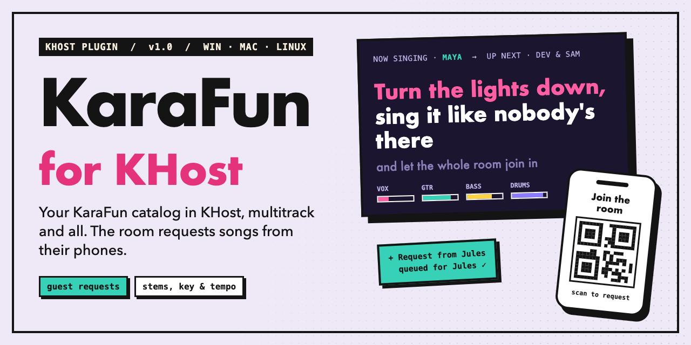

[](https://github.com/ezhalden/KHost.Plugins.KaraFun/releases/latest)
[](#build-it-yourself)
[](https://dotnet.microsoft.com/)
[](#install)
[](https://www.karafun.com/)

# KaraFun for KHost

Bring your KaraFun account into KHost. Search the KaraFun catalog from the **Song Search** panel,
queue a song for a singer, and KHost plays it with its own player: every instrument on its own
track, with key and tempo changes and the words timed to the music.

Guests can join too. Put the sign-up QR code on screen, and anyone in the room can request songs
from their phone. Each request lands on the right singer's queue.

## What you get

- **Catalog search** from KHost's Song Search panel.
- **Community search.** Every search ends with a **Search Community Songs** row that runs the same
  words against KaraFun's user-uploaded songs. *(Least-tested part of the plugin; see
  [Known limits](#known-limits).)*
- **Multitrack playback.** Songs arrive as separate stems (vocals, guitar, bass, drums…), so KHost
  can mix them, change key or tempo, and send them to a Cast screen.
- **Synced lyrics**, taken from the song's own timing.
- **Guest requests from phones**, with a per-guest rate limit.
- **Stays signed in.** Sign in once; the plugin quietly renews the session when KaraFun expires it.

## Install

**From KHost:** open **Plugins → Available**, install **KaraFun Integration**, restart KHost.

**By hand:** unzip a [release](https://github.com/ezhalden/KHost.Plugins.KaraFun/releases/latest)
into its own folder under KHost's `plugins/` directory, enable it on the Plugins page, restart.

One build covers Windows, macOS and Linux.

## Getting started

1. **Sign in.** Use the **Sign in** button on the plugin's row in **Plugins**, or just search; the
   results show a "Sign in to KaraFun" row until you do. Enter your KaraFun email and password.
2. **Search and queue.** Pick a song, hit **Enqueue**, and it downloads and joins the selected
   singer's queue.
3. **Let the room in (optional).** Show the **KaraFun guest sign-up** QR code on screen. Guests scan
   it, pick a name, and request songs.

No KaraFun account yet? Sign up on [karafun.com](https://www.karafun.com/) first. The plugin can't
create one for you.

## Settings

| Setting | Default | What it does |
|---|---|---|
| Requests per window | `5` | How many songs one guest can request per window. `0` means no limit. |
| Window (minutes) | `10` | The window that limit counts over. |
| Single use downloads | on | Deletes a song's file once it's been sung and nothing else in the queue needs it. It downloads again next time (you'll need to be signed in). |

Changes apply right away, no restart.

Your KaraFun login isn't a setting on purpose. See [Your account](#your-account).

## Your account

- **Playback needs you signed in.** Sign out mid-show and KaraFun songs stop with "Sign in to
  KaraFun to play this track." The check uses the session KHost already has, so it never waits on
  the network.
- **Your password is never saved.** The plugin keeps your email and a hash of the password, which
  is what KaraFun's sign-in actually uses.
- **That hash still works like a password.** Anyone who gets it can sign in as you. It's stored as
  plain JSON in KHost's cache folder (not in plugin settings, so it never shows on the Plugins page
  or in `plugins.json`). The other option was asking for your password every launch, which doesn't
  work when the first singer of the night shows up through their phone and nobody is at the
  console. **Sign out** deletes it.
- **Brief network drops don't sign you out.** Only KaraFun actually rejecting your login does, and
  KHost tells you why.

## Guest requests

- A request goes to the singer the guest named, never to whoever happens to be selected at the
  console.
- **Phones are remembered for the night.** Once a phone has requested as "Maya", its next
  requests go to Maya even if the name is typed differently. A phone locking or leaving the room
  doesn't break that; a different name from the same phone means a different person.
- Those links are cleared when you sign out, turn guest requests off, or a new room starts. On a
  later night a regular is matched by name again, same as KaraFun's own app does it.

> [!IMPORTANT]
> **The QR code is the only lock on the door.** Anyone with the room's link can request songs, and
> KaraFun's app works the same way. If it gets passed around, take the code off the screen. The
> per-guest rate limit is the only other brake.

## Known limits

- **Guests can only add songs.** They can't see the queue, remove or reorder songs, or control
  playback, and key, tempo or stem choices sent with a request are ignored.
- **Community songs are the least-tested part.** Search results are confirmed against the live
  service; downloading community songs hasn't been checked end to end. Some KaraFun plans may not
  allow community songs at all, and right now that shows up as a failed download without a clear
  message.
- **No sign-up notifications.** KaraFun doesn't offer a way to be told when someone creates an
  account, so the plugin doesn't try.

Open items live in [`TODO.md`](TODO.md). For how it works inside, see
[`docs/how-it-works.md`](docs/how-it-works.md).

## Build it yourself

You need the .NET 10 SDK plus the `KHost.Abstractions` and `KHost.Common` 0.61.0 packages. Those
aren't on nuget.org, so build them into a local feed with KHost's `./build/pack-contracts.sh` and
add the feed once (no KHost checkout needed after that):

```bash
dotnet nuget add source ~/.nuget/khost-local -n khost-local
```

Then:

```bash
dotnet build KHost.Plugins.KaraFun.slnx
dotnet test tests/KHost.Plugins.KaraFun.Tests
```

To install a local build by hand, copy the entry dll, `manifest.json` and the dependency dlls into
a folder under KHost's `plugins/` directory.

---

<sub>Not affiliated with or endorsed by KaraFun. You need your own KaraFun subscription, and you're responsible for using it within KaraFun's terms.</sub>
